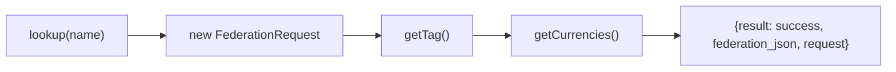

# payments-federation-builder

An ES6 base class for building a Ripple/Internet Payments Federation server: subclass `FederationService`, override two methods, and `lookup(name)` returns a protocol-shaped federation response.

> [!NOTE]
> Dormant since 2015-04-16 on `master` (a WIP branch reaches 2015-05-30). Written for Babel 5 and `babel-node` in the Ripple era; dependencies are from 2015 and were not run on current Node in this pass. The default `getTag()` and `getCurrencies()` return hard-coded example data, and there are no automated tests.

## What it does

`FederationService` turns a name into the JSON a federation client expects. Out of the box it answers every lookup with a fixed destination tag and one USD currency; a subclass overrides `getTag()` and `getCurrencies()` to return real values.

## How it works



- `lib/federation_service.js`: `FederationService(domain, address)`, with `getTag()`, `getCurrencies()` and `lookup(name)`. Both getters return Promises, so subclasses can fetch from a database.
- `lib/federation_request.js`: `FederationRequest(name)`, a holder for the name, tag and currencies of one lookup.
- The response has `result: "success"`, a `federation_json` record (`destination`, `destination_tag`, `dt`, `currencies`, `domain`, `type: "federation_record"`, `destination_address`) and an echo of the `request`.

The client half is [payments-federation-client](https://github.com/stevenzeiler/payments-federation-client). This repo only builds the response object; it contains no HTTP server.

## Getting started

Requires `babel-node` (ES6 modules); the `babel` 5 package in `package.json` provides it.

```bash
npm install
node_modules/.bin/babel-node test/federation_service.js     # prints the default response
node_modules/.bin/babel-node test/random_subclass.js        # subclass with a random tag
```

`npm test` is the npm placeholder and exits with an error. The two files in `test/` are demo scripts that print output, not assertions.

## Usage

Install from a checkout; consumers must compile `node_modules/payments-federation-builder` with Babel, because `main` is untranspiled ES6 **(inference: Babel 5 skips `node_modules` by default)**.

```js
import Federation from 'payments-federation-builder'

class MyFederation extends Federation {
  getTag() {
    return Promise.resolve(Math.floor(Math.random() * 10000000))
  }
}

let federation = new MyFederation('example.net', '<ripple-address>')
federation.lookup('joseph123').then(response => console.log(response))
```

This mirrors `test/random_subclass.js`.

## Project history

Created 2015-04-16 as an "Abstract FederationService class", with two same-day fixes to the package `main`. The remote branch `feature/tag-not-supported` has a further `[WIP] Async federation lookup and quotes` commit dated 2015-05-30 that is not on `master`.

## License

ISC, as declared in `package.json`. There is no LICENSE file in the repo.
